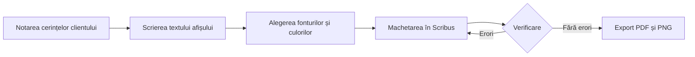

# Proiect: Afiș pentru Balul Bobocilor – Anii '80

Acest document organizează cerințele clientului, specificațiile tehnice și etapele realizării afișului pentru Balul Bobocilor 2026. Include calculele pentru fotografia de fundal, diagrama procesului și verificările documentelor exportate.

## 1. Cerințele clientului

- **Client:** Consiliul elevilor al liceului.
- **Eveniment:** Balul Bobocilor 2026.
- **Data și ora:** **vineri, 20 noiembrie 2026**, ora **18:00**.
- **Locul:** sala de festivități.
- **Tema:** **„Anii '80”**.
- **Culori dorite:** **mov, roz aprins și galben**.
- **Elemente obligatorii:** titlul, data și ora, locul, sigla liceului și o fotografie de fundal.
- **Termen de predare:** **6 noiembrie 2026**.
- **Tiraj:** **20 de exemplare** tipărite și publicare pe pagina de Instagram a liceului.
- **Modificarea titlului:** ~~Bal 2026~~ → **Balul Bobocilor – Anii '80**.

## 2. Date tehnice

| Element | Tipar | Ecran |
| :--- | :---: | ---: |
| Dimensiune | A2 – 420 × 594 mm, portret | 1080 × 1350 px |
| Rezoluție | 300 dpi | 96 dpi |
| Model de culoare | CMYK | RGB |
| Format de predare | PDF/X-4 | PNG |

**Formula pentru numărul de pixeli pe o latură:**

\[
N = \frac{L}{25,4} \times R
\]

Legenda notațiilor:
- \(N\) = numărul de pixeli necesari pe latura respectivă, exprimat în **pixeli (px)**;
- \(L\) = lungimea laturii, exprimată în **milimetri (mm)**;
- \(R\) = rezoluția, exprimată în **puncte pe inch (dpi)**;
- \(25,4\) = numărul de milimetri dintr-un inch.

**Calculul dimensiunii minime a fotografiei de fundal pentru tipar (A2, 300 dpi):**

- Lățime: \(N_l = \frac{420}{25,4} \times 300 = 4960,63\), deci minimum **4961 px**.
- Înălțime: \(N_h = \frac{594}{25,4} \times 300 = 7015,75\), deci minimum **7016 px**.

Prin urmare, fotografia de fundal trebuie să aibă cel puțin **4961 × 7016 pixeli** pentru a acoperi formatul A2 la 300 dpi, fără a lua în calcul eventualele margini de tăiere sau bleed.

La termenul **preflight** se referă verificarea tehnică a documentului înainte de tipărire: dimensiuni, fonturi, imagini, culori și eventuale erori de pregătire pentru tipar.[^preflight]

[^preflight]: Preflight-ul este controlul final al fișierului de machetare pentru a depista probleme care ar putea afecta tipărirea sau exportul.

## 3. Etape de lucru

- [x] Notarea cerințelor clientului.
- [ ] Scrierea textului afișului.
- [ ] Alegerea fonturilor și a culorilor.
- [ ] Machetarea în Scribus.
- [ ] Verificarea (preflight).
- [ ] Exportul PDF și PNG.

## 4. Diagrama etapelor

Diagrama prezintă succesiunea etapelor. Dacă verificarea identifică erori, procesul revine la machetare; dacă nu există erori, se continuă cu exportul.

## 5. Verificare

Tabelul de mai jos este pregătit pentru completare după deschiderea fișierelor exportate în Word și într-un browser. Rezultatele efective trebuie bifate după verificarea lor pe calculator.

| Element verificat | Previzualizare | Word | HTML |
| :--- | :--- | :--- | :--- |
| Titlul, autorul și data din antet apar | da | de verificat | de verificat |
| Tabelul are alinierea cerută | da | de verificat | de verificat |
| Formula se afișează ca formulă | da | de verificat | de verificat |
| Nota de subsol apare și are număr | da | de verificat | de verificat |
| Lista de sarcini are casete | da | de verificat | de verificat |
| Diagrama Mermaid (blocul de cod) se desenează | bloc de cod | bloc de cod | bloc de cod |
| Imaginea `diagrama.png` se afișează | da | de verificat | de verificat |
| Diacriticele apar corect | da | de verificat | de verificat |

**Observații după verificarea conversiei:**  
Documentul Word și pagina HTML trebuie comparate efectiv cu previzualizarea din VS Code. Dacă formula, nota de subsol sau casetele listei nu se păstrează corect, se ajustează sintaxa Markdown ori opțiunile Pandoc și se exportă din nou. Diagrama Mermaid din blocul de cod este prezentată ca text sursă în exporturile standard; imaginea separată `diagrama.png` este varianta vizuală a diagramei.

## 6. Verificare cu AI

Aceste observații sunt exemple de verificări preliminare, nu un raport primit de la Gemini sau Claude. Compară-le cu documentul și notează decizia finală după verificarea ta.

1. **Observație:** tabelul tehnic are trei coloane, iar alinierile sunt declarate prin marcajele Markdown. **Decizie:** acceptată – sintaxa folosește `:---`, `:---:` și `---:` pentru stânga, centru și dreapta.
2. **Observație:** dimensiunea minimă a fotografiei trebuie rotunjită în sus la pixeli întregi. **Decizie:** acceptată – rezultatele sunt 4961 × 7016 px, pentru ca fotografia să nu fie sub rezoluția cerută.

După orice corectură acceptată, se repetă exportul în Word și HTML și se verifică din nou fișierele. Datele calendaristice și dimensiunile se păstrează conform cerințelor clientului.
